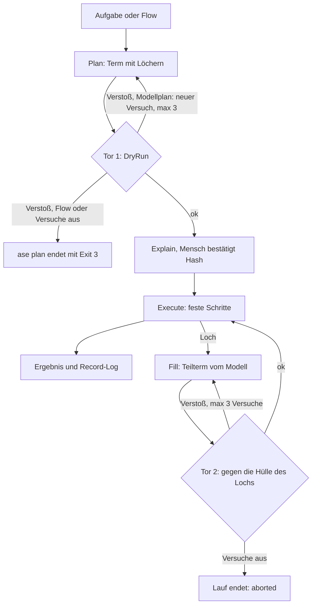

# agentic-step-engine

**Das Sprachmodell schreibt das Programm. `ase` prüft es, ein Mensch gibt es frei, dann erst läuft es.**

Die meisten Coding-Agenten rufen Werkzeuge einzeln auf, und jeder Aufruf wirkt sofort. Hier schreibt das Modell zuerst einen Term: ein kleines Programm aus festen Schritten, mit Löchern an den wenigen Stellen, an denen es später entscheidet. Jedes Loch trägt eine Hülle, die festlegt, was dort höchstens passieren darf: welche Operationen, unter welchem Pfad, wie viele Schritte. Nichts läuft, was nicht vorher geprüft wurde, weder der Plan noch das, was das Modell in ein Loch setzt. Die Hülle vertritt den Menschen.

Gedacht ist es für Abläufe, die man einmal festlegt und oft laufen lässt: ein Release vorbereiten, einen roten Test diagnostizieren, Doku nachziehen. Es ist kein Ersatz für Claude Code oder Cursor im Alltag. `ase` ist ein Prototyp in Scala 3 mit einer Kommandozeile.

**Status:** Prototyp. Engine, Modellanbindung und CLI sind gebaut. Mit Claude über Claude Code bestand jede der sechs Testaufgaben 10 von 10 Läufen ([Details](#evals-und-status)).

> **In English.** `ase` lets a language model do recurring chores on a repository, such as preparing a release or diagnosing a failing test. The model does not call tools one by one. It first writes a small program in a checked language, with *holes* where it decides at run time. Each hole carries an *envelope* that limits which operations, paths and steps are allowed there. Nothing runs before it has been checked, and nothing runs before a human has approved the program's hash. Prototype in Scala 3 under the Apache License 2.0. The documentation is in German.

## Wie es funktioniert

Das Modell schreibt einen **Term**: ein Programm als JSON in einer kleinen, festen Sprache. Sie kennt Datei lesen, ändern, anlegen und verschieben, erlaubte Shell-Befehle, Sequenz, Bedingung und begrenzte Wiederholung. Variablen gibt es nicht. Wo das Modell Daten braucht, die es beim Planen noch nicht hat, setzt es ein **Loch**: „hier entscheide ich später“. Jedes Loch trägt eine **Hülle** (envelope). Sie legt fest, welche Operationen unter welchem Pfad erlaubt sind, wie viele Schritte und welche Shell-Befehle.

1. **Plan.** Das Modell liefert den Term zu einer Aufgabe. Alternativ hat ihn ein Mensch als **Flow** geschrieben (eine Datei in `flows/`).
2. **Tor 1.** Ein **DryRun** prüft den Term, ohne etwas auszuführen. Geprüft werden Pfade, Shell-Befehle und Flags, die Schrittzahl im schlechtesten Fall und die **Attenuation**: Die Hülle jedes Lochs darf höchstens so weit sein wie die umgebende, Rechte werden also nur enger.
3. **Freigabe.** **Explain** zeigt den Term in Klartext, mit der Hülle jedes Lochs. Der Mensch bestätigt einen SHA-256-Hash über diesen Term und seine äußere Hülle. Nur genau das läuft.
4. **Ausführen.** Die festen Schritte laufen. Bei einem Loch fragt `ase` das Modell nach einem Teilterm, einem **Fill**. **Tor 2** prüft ihn gegen die Hülle des Lochs, bevor er läuft.



## Beispiel: Release-Vorbereitung

Mara schneidet alle zwei Wochen ein Release. Zwei Schritte brauchen Urteil: das Changelog aus den Commits formulieren und die Doku-Stellen anpassen, die von geänderten Schnittstellen betroffen sind. Den Rest legt sie in [flows/release.json](flows/release.json) fest. Die Versionsänderung ist ein fester `EditFile` mit Compare-and-Swap: Er ersetzt nur, wenn der alte Text genau einmal vorkommt. Tag und Push macht Mara selbst, `git tag` steht nicht in der Allowlist.

### Was Mara vor der Freigabe sieht

`ase plan` prüft den Flow und legt den Term in einer Plan-Datei ab. Ein Flow braucht dafür kein Modell. `ase run` liest die Datei, prüft neu, zeigt denselben Explain und fragt dann. Die Zeile `explain` nennt den Hash gekürzt, `hash` vollständig zum Kopieren für `--approve`. Die Explain-Ausgabe unten stammt aus einem echten Aufruf.

```
$ ase plan --flow flows/release.json version=2.4.0 previous=2.3.0 --envelope release-envelope.json --config ase.json --out release.plan.json
$ ase run --plan release.plan.json --envelope release-envelope.json --config ase.json --workspace . --record ../ase-records/release-2.4.0.log
dryrun    ok  (worst case 23 steps, depth 2)
explain   06cd1a…8f61
hash      06cd1a1845ded9bf0812f8344e37ac200e1c952942c1270e6e6e366c5b698f61
params    previous=2.3.0 version=2.4.0

1  führt aus: git status --porcelain
   wenn nicht Ausgabe leer:
2    fertig: Arbeitsverzeichnis nicht sauber; bitte erst committen oder stashen
   sonst:
3    führt aus: ./run-tests.sh (führt Workspace-Code aus)
     wenn nicht Exit-Code 0:
4      fragt: „Tests sind rot. Trotzdem weiter?“
5    führt aus: git log --oneline v2.3.0..HEAD
6    Hier entscheidet der Agent: „Formuliere das Changelog für 2.4.0 aus den Commits oben, gruppiert nac…“ (gekürzt, 152 Zeichen)
     darf ReadFile, EditFile · unter CHANGELOG.md · max 3 Schritte · Tiefe 0
     kann Ergebnisse von Schritt 3, 4, 5 sehen
7    Hier entscheidet der Agent: „Finde Doku-Stellen unter docs/, die von geänderten öffentlichen Schnit…“ (gekürzt, 189 Zeichen)
     darf ReadFile, EditFile, Shell · unter docs/ · max 12 Schritte · Tiefe 1 · shell: grep
     kann Ergebnisse von Schritt 3, 4, 5, 6 sehen
8    ersetzt in build.sbt  „version := "2.3.0"“  durch  „version := "2.4.0"“
9    fertig: Release 2.4.0 vorbereitet; Tag und Push macht der Mensch

shell     ./run-tests.sh, git log, git status, grep
nicht erlaubt, u. a.: git push, git commit, git tag, rm, curl

Freigeben? [y/N] y
approved  06cd1a…8f61  → ../ase-records/release-2.4.0.log
```

### Was während des Laufs passiert

Drei Dinge muss man wissen, um das Log zu lesen. Erstens sieht ein Fill die Ergebnisse seiner eigenen Schritte nicht sofort. Endet er ohne `Done`, fragt `ase` das Modell erneut für dasselbe Loch, jetzt mit dem Gelesenen. Das ist eine **Runde**; ein Loch bekommt höchstens 3 davon. Zweitens teilen sich alle Runden das Schrittbudget des Lochs, darum sinkt die Zahl hinter `≤`. Drittens fehlen die Nummern 2 und 4, weil diese Zweige nicht liefen. Die 16 Schritte am Ende zählen alle ausgeführten samt `Done` und einen je angenommenem Loch; abgelehnte Fills kosten Modellaufrufe, aber keine Schritte. Das Log ist konstruiert (echtes Format, erfundene Hashes und Zahlen).

```
1  shell  git status --porcelain             exit 0  (leer)
3  shell  ./run-tests.sh                     exit 0  (12 Zeilen)
5  shell  git log --oneline v2.3.0..HEAD     exit 0  (23 Zeilen)

6  hole   „Formuliere das Changelog für 2.4.0 aus den Commits…“
   fill   → Seq(ReadFile CHANGELOG.md, EditFile build.sbt)
   dryrun rejected  $.steps[1].path: Pfad „build.sbt“ liegt außerhalb von CHANGELOG.md; erlaubt ist nur CHANGELOG.md. Ist dort etwas betroffen, nenne es im Ergebnis.
          → an Modell: „Dein Teilterm wurde abgelehnt und nicht ausgeführt:⏎- $.steps[1].path: Pfad „build.sbt“ liegt außerhalb von CHANGELOG.md; erlaubt ist nur CHANGELOG.md. Ist dort…“
   fill   → Seq(ReadFile CHANGELOG.md)   hash a41c07…9e2f
   dryrun ok (1 steps ≤ 3)
   read   CHANGELOG.md                       (214 Zeilen)
   round  Runde 2: der Fill davor endete ohne Done, seine Ergebnisse gehen mit
   fill   → Seq(EditFile CHANGELOG.md, Done)   hash 5d2e11…08ac
   dryrun ok (2 steps ≤ 2)
   edit   CHANGELOG.md                       (CAS ok, +31 Zeilen)
   done   Changelog 2.4.0 ergänzt: 4 Features, 9 Fixes, 1 Breaking

7  hole   „Finde Doku-Stellen unter docs/, die von geänderten…“
   fill   → Seq(Shell grep, ReadFile docs/api.md, ReadFile README.md)
   dryrun rejected  $.steps[2].path: Pfad „README.md“ liegt außerhalb von docs/; erlaubt ist nur docs/. Ist dort etwas betroffen, nenne es im Ergebnis.
          → an Modell: „Dein Teilterm wurde abgelehnt und nicht ausgeführt:⏎- $.steps[2].path: Pfad „README.md“ liegt außerhalb von docs/; erlaubt ist nur docs/. Ist dort etwas betroff…“
   fill   → Seq(Shell grep, ReadFile docs/api.md, ReadFile docs/migration.md)   hash 9b07c3…41d0
   dryrun ok (3 steps ≤ 12)
   shell  grep -rn parseConfig docs/         exit 0  (3 Zeilen)
   read   docs/api.md                        (180 Zeilen)
   read   docs/migration.md                  (64 Zeilen)
   round  Runde 2: der Fill davor endete ohne Done, seine Ergebnisse gehen mit
   fill   → Seq(EditFile docs/api.md, EditFile docs/migration.md, Done)   hash 2c8140…b7e3
   dryrun ok (3 steps ≤ 9)
   edit   docs/api.md                        (CAS ok, +0 Zeilen)
   edit   docs/migration.md                  (CAS ok, +2 Zeilen)
   done   parseConfig in docs/api.md und docs/migration.md angepasst; README.md laut Commit-Log vermutlich betroffen, nicht gelesen

8  edit   build.sbt                          (CAS ok, +0 Zeilen)
9  done   Release 2.4.0 vorbereitet; Tag und Push macht der Mensch

Lauf beendet
16 Schritte · 6 Modellaufrufe · 0 Ablehnungen an Tor 1 · 2 Ablehnungen an Tor 2 · 4 Dateien geändert · 23.4k Tokens
Hinweis des Agenten (Loch 6): Changelog 2.4.0 ergänzt: 4 Features, 9 Fixes, 1 Breaking
Hinweis des Agenten (Loch 7): parseConfig in docs/api.md und docs/migration.md angepasst; README.md laut Commit-Log vermutlich betroffen, nicht gelesen
../ase-records/release-2.4.0.log · approved 06cd1a…8f61
```

Die erste Ablehnung verhindert Schaden. Das Changelog-Loch wollte nebenbei die Version in `build.sbt` anheben. Das Loch durfte nur `CHANGELOG.md` anfassen; eine stille Versionsänderung an anderer Stelle wäre im Explain nie sichtbar gewesen (und hätte Schritt 8 scheitern lassen). Tor 2 lehnt ab, bevor etwas läuft, und der Lauf geht weiter. Die zweite Ablehnung ist die ehrliche Seite: Das Modell wollte etwas Sinnvolles tun und durfte nicht. Es nennt die Stelle im Ergebnis, und Mara entscheidet selbst.

## Warum nicht einfach Claude Code mit Regeln?

Ein Coding-Agent wie Claude Code lässt sich gut einzäunen. Der Plan-Modus zeigt vorher einen Plan. Erlaubnisregeln geben Werkzeuge, Befehlsmuster und Pfade frei. Subagents bekommen eigene Werkzeuglisten. Hooks können einzelne Aufrufe blockieren, und ein Devcontainer isoliert das Ganze. Was dabei bleibt:

- **Der Plan bindet nicht.** Im Plan-Modus ist der Plan Prosa, und danach ruft der Agent wieder Werkzeuge einzeln auf. Hier *ist* der freigegebene Plan das Programm, das läuft. Es ist an seinen Hash gebunden, und seine Schrittzahl hat eine feste Obergrenze.
- **Rechte gelten pro Loch, mit Pfad und Schrittbudget, und werden vor dem Lauf geprüft.** Das Changelog-Loch darf nur `CHANGELOG.md` ändern, das Doku-Loch nur unter `docs/`. Beide laufen im selben Lauf. Anders als die Werkzeuglisten eines Subagenten sind die Hüllen Teil des freigegebenen Hashes und werden vor jedem Fill geprüft.
- **Einmal freigeben, oft laufen lassen.** Bei einem Flow ist der Hash stabil: `ase run --approve <hash> --no-ask` läuft ohne Menschen davor, etwa in CI. Ändern sich Flow, Parameter oder die Hülle im Flow, ändert sich der Hash, und `ase run` gibt nicht frei (Exit 4); eine andere `--config` lehnt es ab. Ein vom Modell geplanter Term ist jedes Mal ein anderer und braucht jedes Mal eine Freigabe.
- **Entscheidungen zur Laufzeit gehen durch ein Tor.** Jeder Fill wird gegen die Hülle geprüft, bevor auch nur ein Schritt davon läuft. Bei einer Ablehnung bekommt das Modell die Begründung, und der Lauf geht weiter.

**Wogegen es nicht schützt.** `ase` schützt vor dem, was das Modell tut, nicht vor Code im Repository. Erlaubte Programme wie `./run-tests.sh` oder `sbt test` laufen ohne Sandbox und können alles, was der Nutzer kann; Explain markiert sie als „führt Workspace-Code aus“. Es gibt keine Isolation, also gehört ein Container drumherum. Geprüft werden Ort und Art einer Änderung, nicht ihr Inhalt: Ein Loch kann innerhalb seiner Hülle schlechte Arbeit machen. Es gibt kein Zurückrollen; was gelaufen ist, bleibt gelaufen. Hüllen, die ein Modell selbst plant, können weiter sein als nötig; Tor 1 lehnt nur ab, was über die äußere Hülle hinausgeht. Explain nennt ein Loch, das Code ändern darf, der danach läuft (D#62). Den Explain muss also jemand lesen. Weitere Restrisiken stehen in D#43.

**Was es kostet.** Es braucht mehr Modellaufrufe: einen Plan und je Loch mindestens einen Fill, dazu Runden und Versuche. Claude kam je nach Aufgabe auf 11k bis 61k Tokens je Lauf (siehe [Evals und Status](#evals-und-status)), Gemini Flash über agy auf 231k (M#3). Hüllen wollen geschrieben und gelesen werden. Die Sprache kann nur Dateien bearbeiten und eine kleine Liste von Shell-Befehlen aufrufen. Ein Vergleich mit einem Agenten, der Werkzeuge direkt aufruft, ist nicht gemessen.

Kennungen wie O#28, D#43 und M#4 verweisen auf [findings.md](findings.md): D# ist eine Entscheidung, M# eine Messung, O# ein offener Punkt.

## Schnellstart

Voraussetzungen: JDK 17 und sbt 1.10.7. `ase plan` läuft überall. `ase run` führt nur unter Linux aus, unter Windows also in WSL. Unter Windows startet Java `.bat` und `.cmd` über cmd.exe, eine versteckte Shell (D#29). macOS ist ungetestet und deshalb gesperrt.

Die Befehle sind bash (Linux, WSL, Git Bash).

```
git clone https://github.com/schneist/agentic-step-engine.git && cd agentic-step-engine
sbt test                 # außerhalb von Linux sind die Execute-Tests sichtbar übersprungen
export PATH="$PWD/bin:$PATH"
ase plan …               # bin/ase baut beim ersten Aufruf und nach Änderungen, danach startet es nur java
```

**Ohne Modell:** Ein Flow wird ohne Modell geprüft und erklärt.

```
$ ase plan --flow flows/red-test.json --envelope evals/6-red-test/envelope.json --config evals/runner.json --out red.plan.json
dryrun    ok  (worst case 19 steps, depth 1)
explain   dcd18e…93bf
...
```

**Mit Modell** (Eval 1: TODOs sammeln, in einer Kopie des Fixtures). Gemessen ist nur der Weg über Claude Code. Dafür in `evals/runner-claude-code.json` das Feld `model.endpoint` auf den eigenen `claude` setzen (`which claude`) und `model.workDir` auf ein beschreibbares Verzeichnis setzen oder das Feld löschen (dann das temporäre Verzeichnis der JVM).

```
rm -rf /tmp/work && cp -a evals/1-todos/fixture /tmp/work
C=evals/runner-claude-code.json
ase plan --task evals/1-todos/task.md --envelope evals/1-todos/envelope.json --config $C --out todo.plan.json
ase run  --plan todo.plan.json --envelope evals/1-todos/envelope.json --config $C --workspace /tmp/work
```

### CLI-Referenz

```
ase plan --envelope E (--task T | --flow F [name=wert …]) --out P [--summary S] [--config C]
ase run  --plan P --envelope E --workspace W [--approve HASH] [--record R] [--summary S] [--no-ask] [--config C]
```

- `--approve` nimmt die 64 Hex-Zeichen der Zeile `hash` und gibt ohne Rückfrage frei. Ohne Terminal immer damit aufrufen.
- `--no-ask` beantwortet `Ask`-Fragen nicht; der Lauf endet dann mit `ask`.
- `--summary` schreibt Kennzahlen als JSON, bei `plan` auch dann, wenn kein Plan zustande kam.
- `plan` und `run` brauchen dieselbe `--config`.
- Exit-Codes von `run`: 0 done, 2 ask, 3 aborted, 4 nicht freigegeben, 1 Fehler. Von `plan`: 0 geprüft, 2 keine Mehrheit (nur mit `bestOfN`), 3 abgelehnt, 1 Fehler.
- Messserien: `evals/series.sh <eval-verzeichnis> <n> <ausgabe> [--config datei]` für eine Eval, `evals/harness.sh <n> <ausgabe> [--config datei]` für alle sechs.

Die Konfiguration (`--config`) ist JSON; jedes Feld ist optional, unbekannte Felder sind Fehler. `model.provider` legt fest, wer plant und füllt:

| `provider` | Weg | Anmeldung | Standardmodell | Beispiel |
|---|---|---|---|---|
| `claudecode` | `claude --print`, ohne Werkzeuge | angemeldetes Claude Code | claude-opus-5-5 | `evals/runner-claude-code.json` |
| `anthropic` (Standard) | Messages API | Umgebungsvariable `ANTHROPIC_API_KEY` | claude-opus-5-5 | `evals/runner.json` |
| `agy` | Antigravity-CLI | angemeldete CLI | gemini-3.8-flash-medium | `evals/runner-agy.json`, `evals/runner-agy-argon.json` |
| `ollama` | lokal, Port 11434 | keine | qwen3:4b-instruct | `evals/runner-ollama.json` |

Dazu kommen `limits`, `scripts`, `explainDenials`, `nestingLimit`, `planRounds` und `bestOfN`. Mit `bestOfN` größer 1 erzeugt jede Plan-Runde so viele Pläne, und einer gilt nur, wenn die Mehrheit dieselbe Form hat: denselben Ablauf, dieselben Operationen, dieselben Rechte der Löcher. Sonst entscheidet der Mensch, und `ase plan` endet mit Exit 2 (D#63, D#65). Standard ist 1, weil Aufgaben mit mehreren guten Wegen sonst meist beim Menschen landen (O#32). Einzelheiten in [RunnerConfig.scala](runner/src/main/scala/ase/runner/RunnerConfig.scala).

## Einen Flow schreiben

Ein Flow ist ein JSON-Objekt mit genau vier Feldern:

- `description`: Text.
- `params`: Name → Regex. Die Werte kommen als `name=wert` zu `ase plan`.
- `envelope`: die Hülle des Flows. Sie darf nicht weiter sein als `--envelope`.
- `term`: der Term. Jeder Knoten hat `type` und `origin: "Human"`.

`${name}` wird nach dem Parsen und nur in Textfeldern ersetzt, nie als JSON. Ein ungebundener Name ist ein Fehler. Vorlagen sind [flows/release.json](flows/release.json) und [flows/red-test.json](flows/red-test.json). Vor dem ersten Lauf `ase plan --flow …` aufrufen und den Explain lesen.

Was ein Flow wie der Release-Flow im eigenen Repository braucht: `ase.json` mit `{ "scripts": ["./run-tests.sh"] }`, denn Skripte laufen nur, wenn sie dort stehen. Dazu `release-envelope.json`, die äußere Hülle; sie muss mindestens so weit sein wie die Hülle im Flow, am einfachsten ist eine Kopie des Felds `envelope` aus `flows/release.json`. `ase plan` braucht für jeden Parameter in `params` einen Wert, der zur Regex passt. Das Record-Log muss außerhalb von `--workspace` liegen. Mit `--workspace .` und ohne `--record` bricht `ase run` ab, denn der Standard `record/…` läge im Arbeitsverzeichnis.

## Referenz

### Die Term-Sprache

```
Term ::= ReadFile(path) | ListDir(path)                -- ListDir samt Unterverzeichnissen, Ebene für Ebene
       | WriteFile(path, content)                    -- nur neue Dateien
       | EditFile(path, expectedOld, replacement)    -- Compare-and-Swap, expectedOld genau einmal
       | MoveFile(from, to)                          -- Ziel darf nicht existieren
       | Shell(cmd, args) | Ask(question) | Done(summary)
       | Seq(steps) | If(pred, thenT, elseT) | RepeatUntil(body, until: pred, max)
       | Hole(goal, envelope)

Pred ::= FileExists(path) | LastExitCode(code) | LastOutputContains(text) | LastOutputEmpty | Not(p) | And(p, q)
```

Die Sprache hat keine Fortsetzungen, Lambdas oder Variablen. Alles, was den Inhalt eines Ergebnisses verarbeiten muss, ist ein Loch. Jeder Knoten trägt `origin: Human | Model(callId)`, und Flows und Modellpläne werden gleich behandelt. Wer prüft oder erklärt, sieht beide Zweige von `If` und `RepeatUntil`; nur die Ausführung wählt. `Ask` kann auch mitten im Lauf eine Frage stellen.

### Hüllen

```
Envelope(allowedOps, pathPrefix, maxSteps, maxDepth, shellAllowlist)
AllowedCommand(binary, requiredPrefixArgs)     -- "git" + ["status"], nicht nur "git"
OpKind ::= ReadFile | ListDir | WriteFile | EditFile | MoveFile | Shell | Ask | Hole
```

`Ask` und `Hole` sind nur erlaubt, wenn die Hülle sie nennt: Ein Loch darf dann nachfragen oder Unterlöcher setzen. Shell-Befehle laufen ohne `sh -c`, ohne Pipes und ohne Umleitungen. Erlaubte Flags legt eine Argument-Policy je Programm fest. Die übrigen Argumente sind je nach Programm Pfade, ein Suchmuster (grep) oder ein Revisionsbereich (git log); Pfade werden wie bei `ReadFile` geprüft.

Attenuation heißt: `allowedOps` ist eine Teilmenge der äußeren, jeder Shell-Befehl gleich oder enger (`git status` unter `git`), `pathPrefix` liegt darunter, `maxDepth` ist strikt kleiner, und die Schritte im schlechtesten Fall sind höchstens das `maxSteps` des äußeren Lochs. Ein Fill wird mit einem Decoder gelesen, der nicht erlaubte Operationsarten gar nicht kennt. Pfade, Befehle, Flags und Budget prüft danach der DryRun.

### Interpreter

Derselbe Term hat mehrere Deutungen. `DryRun` prüft, `Cost` schätzt, `Explain` übersetzt für Menschen, `Execute` führt aus. `Replay` spielt ein Record-Log in Tests ohne Modell und Dateisystem ab. Interpreter lesen den Term und verändern ihn nie. Typen erzwingen die Reihenfolge: `Execute` nimmt nur einen Term, der geprüft und freigegeben ist.

Die Module: `core` enthält Sprache, Prüfung und Interpreter, ohne HTTP und Modell; `model` die Adapter der vier Anbieter; `runner` die CLI.

## Evals und Status

Sechs Aufgaben mit bekanntem Ergebnis liegen in [evals/](evals/README.md). Eval 6 ist zugleich der deterministische Integrationstest ohne Modell. `evals/harness.sh` misst alle sechs mit derselben Konfiguration. Gemessen mit claude-opus-5-5 und effort high über `claude --print`, je 10 Läufe; Eval 1 und 6 nach der letzten Änderung am Prompt (D#66), die übrigen davor.

| Eval | Aufgabe | Erfolg | Tokens ø je Lauf | Messung |
|---|---|---|---|---|
| 1 | TODO-Kommentare in TODO.md sammeln | 10/10 | 30,2k | M#12 |
| 2 | Datei umbenennen, Verweise anpassen | 10/10 | 30,3k | M#7 |
| 3 | Roten sbt-Test diagnostizieren, nichts ändern | 10/10 | 59,8k | M#8 |
| 4 | README aus den Quellen schreiben | 10/10 | 52,5k | M#9 |
| 5 | Aufgabe außerhalb der Hülle: fragen statt umgehen | 10/10, jedes Mal ask | 11,1k | M#10 |
| 6 | Roten Test reparieren und berichten | 10/10 | 61,2k | M#13 |

- **Tiefe Verzeichnisse.** Eval 4 scheiterte vorher, weil jede Verzeichnisebene eine Runde kostete. Seit ListDir samt Unterverzeichnissen listet (D#61), beginnt jeder Plan mit einem Listing des ganzen Arbeitsverzeichnisses.
- **Kein Loch über dem Testskript.** In der Serie davor (M#5) durfte in jedem Eval-6-Plan ein Loch `./run-tests.sh` ändern, das danach lief. Jetzt in keinem: Die Pläne trennen Diagnose, Reparatur unter `src/` und Bericht (D#62).
- **Das kostet.** Die Trennung hebt Eval 6 von 45,0k auf 61,2k Tokens. Eine erste Fassung der Regel teilte auch in Eval 1, wo kein Code läuft; seit D#66 gilt sie nur dort, wo sie schützt, und Eval 1 ist wieder bei 30,2k.
- **BestOfN.** Mit drei Plänen je Runde fand Eval 1 in 9 von 10 Läufen eine Mehrheit, Eval 6 nur in 4 von 10, weil es dort mehrere gute Wege gibt (M#14, M#15). Deshalb ist es standardmäßig aus.
- **Andere Anbieter.** Gemini 3.8 Flash über agy bestand Eval 1 in 1 von 5 Läufen (M#3).

Weiterlesen: [SPEC.md](SPEC.md) (Spezifikation, Grenzen und Limits), [findings.md](findings.md) (Entscheidungen, Messungen, offene Punkte), [context.md](context.md) mit [Glossar](context.md#7-glossar) und dem [Warum jeder Entscheidung](context.md#8-warum), [architecture.md](architecture.md), [CLAUDE.md](CLAUDE.md) (Arbeitsregeln).

## Lizenz

Apache License 2.0, siehe [LICENSE](LICENSE).
