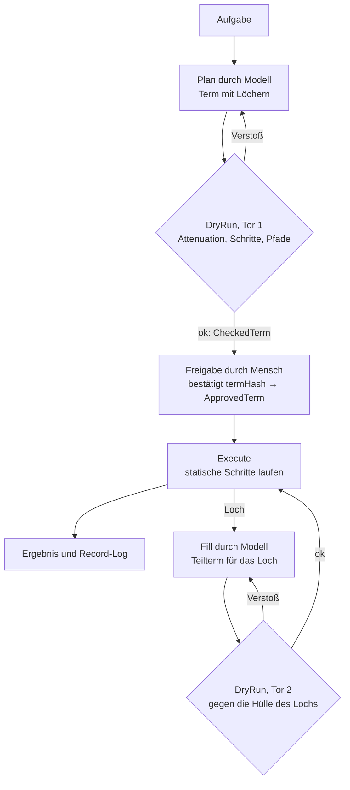

# agentic-step-engine

Eine Engine, die Agentenprogramme eines Sprachmodells als **Terme** entgegennimmt, sie vor der Ausführung prüft und nur das ausführt, was geprüft wurde. Terme dürfen **Löcher** enthalten: Stellen, an denen das Modell erst zur Laufzeit entscheidet. Jedes Loch trägt eine **Hülle**, die festlegt, was dort maximal passieren darf.

Die zentrale Invariante: **Nichts wird ausgeführt, was nicht vorher geprüft wurde.** Weder der Plan noch ein zur Laufzeit geliefertes Teilprogramm.

Das Warum zu jeder Entscheidung steht in [context.md](context.md) §8. Die technische Spezifikation in [SPEC.md](SPEC.md). Die Entscheidungen selbst in [findings.md](findings.md).

## Idee in einem Absatz

Ein normaler Coding-Agent ruft Werkzeuge einzeln auf, und die Umgebung führt jeden Aufruf sofort aus. Es gibt kein Programm, nur eine Folge von Effekten; man kann sie weder vorab prüfen noch vernünftig freigeben. Hier schreibt das Modell stattdessen einen Term in einer kleinen, statischen Sprache (Sequenz, Bedingung, begrenzte Wiederholung, Werkzeugaufrufe). Wo es Daten braucht, die es noch nicht hat, setzt es ein Loch mit einer Hülle. Die Engine prüft den Term (DryRun), ein Mensch gibt ihn einmal frei, und beim Ausführen wird jedes Loch vom Modell gefüllt und das Füllstück gegen die Hülle geprüft, bevor es läuft. Die Hülle vertritt den Menschen.

## Lebenszyklus eines Terms



Das Modell entscheidet zweimal: beim Plan und bei jedem Loch. Beide Male steht ein Tor dahinter, das dieselbe Prüfung macht. Der Mensch gibt nur den Plan frei.

## Beispiel: Release-Vorbereitung

Mara schneidet alle zwei Wochen ein Release. Die Schritte sind immer gleich, aber zwei davon brauchen Urteil: das Changelog aus den Commits formulieren und die Doku-Stellen finden, die von geänderten Schnittstellen betroffen sind. Sie schreibt den Ablauf einmal als Flow mit zwei Löchern, siehe [flows/release.json](flows/release.json).

Die gefährlichen Schritte (Versionsnummer, Tag, Push) sind **keine** Löcher. Die Versionsänderung ist ein fester `EditFile` mit Compare-and-Swap; Tag und Push macht Mara selbst, `git tag` steht nicht einmal in der Allowlist. Das Modell bekommt Urteil nur dort, wo Urteil gebraucht wird, und jedes Loch hat genau die Rechte, die seine Aufgabe braucht.

### Was Mara vor der Freigabe sieht

```
$ ase run flows/release.json version=2.4.0 previous=2.3.0
dryrun    flows/release.json  ok  (worst case 23 steps, depth 2)
explain   7f3a9c…e21b
hash      7f3a9c…(64 Hex-Zeichen)…e21b
params    version=2.4.0 previous=2.3.0

1  Prüft, ob das Arbeitsverzeichnis sauber ist (git status); endet sonst
2  Führt ./run-tests.sh aus (Workspace-Code); fragt nach, wenn rot
3  Liest die Commits seit v2.3.0 (git log)
4  Hier entscheidet der Agent
   ändert CHANGELOG.md · nur diese Datei · max 3 Schritte · Tiefe 0
5  Hier entscheidet der Agent
   liest und ändert unter docs/ · grep erlaubt · max 12 Schritte · Tiefe 1
6  Ersetzt in build.sbt  version := "2.3.0"  durch  version := "2.4.0"
7  Fertig: Release 2.4.0 vorbereitet; Tag und Push macht der Mensch

shell     ./run-tests.sh, grep, git status, git log
nicht erlaubt, u. a.: git tag, git push, git commit

Freigeben? [y/N] y
approved  7f3a9c…e21b  → record/2026-10-27T14-02.log
```

### Was während des Laufs passiert

```
1  shell  git status --porcelain            exit 0  (leer)
2  shell  ./run-tests.sh                     exit 0  (47 tests)
3  shell  git log --oneline v2.3.0..HEAD     exit 0  (23 Zeilen)

4  hole   "Formuliere das Changelog…"
   fill   → Seq(ReadFile CHANGELOG.md, EditFile CHANGELOG.md)   hash a41c…
   dryrun ok (2 steps ≤ 3)
   read   CHANGELOG.md
   edit   CHANGELOG.md  (Kopf ersetzt, +31 Zeilen)

5  hole   "Finde Doku-Stellen, die von geänderten Schnittstellen…"
   fill   → Seq(Shell grep, ReadFile docs/api.md, EditFile docs/api.md, EditFile README.md)
   dryrun rejected  EditFile README.md: Pfad außerhalb docs/
          → an Modell: "erlaubt ist docs/; wenn README.md betroffen ist, nenne es im Ergebnis"
   fill   → Seq(Shell grep, ReadFile docs/api.md, EditFile docs/api.md, EditFile docs/migration.md)   hash 9b07…
   dryrun ok (4 steps ≤ 12)
   shell  grep -rn "parseConfig" docs/        exit 0  (3 Treffer)
   read   docs/api.md
   edit   docs/api.md          (1 Stelle ersetzt)
   edit   docs/migration.md    (1 Stelle ersetzt)

6  edit   build.sbt            version 2.3.0 → 2.4.0  (CAS ok)
7  done   Release 2.4.0 vorbereitet; Tag und Push macht der Mensch

Lauf beendet
13 Schritte · 3 Modellaufrufe · 1 Ablehnung an Tor 2 · 4 Dateien geändert · 18.4k Tokens
Hinweis des Agenten: README.md enthält ein veraltetes parseConfig-Beispiel (außerhalb der Hülle, nicht geändert)
record/2026-10-27T14-02.log · approved 7f3a9c…e21b
```

Der abgelehnte Fill ist die Pointe: Das Modell wollte etwas Sinnvolles tun, durfte es nicht, hat den Hinweis ins Ergebnis geschrieben, und Mara entscheidet am Ende selbst, ohne dass der Lauf stehen blieb.

## Die Term-Sprache

```
Term ::= ReadFile(path) | ListDir(path)
       | WriteFile(path, content)                    -- nur neue Dateien
       | EditFile(path, expectedOld, replacement)    -- Compare-and-Swap, expectedOld genau einmal
       | MoveFile(from, to)                          -- Ziel darf nicht existieren
       | Shell(cmd, args) | Ask(question) | Done(summary)
       | Seq(steps)
       | If(pred, thenT, elseT)
       | RepeatUntil(body, until: pred, max)
       | Hole(goal, envelope)

Pred ::= FileExists(path) | LastExitCode(code) | LastOutputContains(text) | LastOutputEmpty | Not(p) | And(p, q)
```

Keine Fortsetzungen, keine Lambdas, keine Variablen. Alles, was den Inhalt eines Ergebnisses inspizieren muss, ist ein Loch. Jeder Knoten trägt `origin: Human | Model(callId)`; Terme können aus `flows/` geladen oder vom Modell erzeugt werden, die Engine behandelt beide gleich. Eine Flow-Datei enthält neben dem Term eine Beschreibung, ihre Hülle und typisierte Parameter wie `${version}`, die erst nach dem Parsen in Textfelder eingesetzt werden. `If` und `RepeatUntil` sind eigene Operationen der Algebra: Wer prüft oder erklärt, sieht beide Zweige, nur Execute wählt.

## Hüllen

```
Envelope(allowedOps, pathPrefix, maxSteps, maxDepth, shellAllowlist)
AllowedCommand(binary, requiredPrefixArgs)     -- "git" + ["status"], nicht nur "git"
OpKind ::= ReadFile | ListDir | WriteFile | EditFile | MoveFile | Shell | Ask | Hole
```

`Ask` und `Hole` stehen nur in einer Hülle, wenn sie ausdrücklich erlaubt sind: Ein Loch darf dann nachfragen beziehungsweise Unterlöcher setzen. Welche Flags ein erlaubtes Programm bekommt, regelt eine Argument-Policy in der Runner-Konfiguration; Argumente, die keine Flags sind, werden als Pfade geprüft.

Attenuation: Die Hülle eines inneren Lochs ist nie weiter als die des äußeren. `allowedOps` Teilmenge; jeder Shell-Befehl gleich oder enger (`git status` unter `git`); `pathPrefix` kanonisch darunter; `maxDepth` strikt kleiner; Worst-Case-Schritte des Teilbaums höchstens `maxSteps` des Elternlochs. Ein Fill wird mit einem Decoder gelesen, der nur die Knoten der Hülle kennt, und gegen eine Algebra gefaltet, die nur erlaubte Operationen weiterreicht: Verbotenes wird nicht geprüft und abgelehnt, es kommt im Term gar nicht vor.

## Interpreter

Derselbe Term, verschiedene Deutungen. `DryRun` prüft, `Cost` schätzt, `Explain` übersetzt für Menschen, `Execute` führt aus, `Replay` spielt eine Aufzeichnung ab. Interpreter lesen den Term und verändern ihn nie. Der Term ist eine Partitur: Execute spielt sie, Explain liest sie vor, Cost zählt die Takte, DryRun prüft, ob alle Noten im Tonumfang liegen, Replay spielt die Aufnahme ab. Die Partitur ändert sich nie.

## Evals

Sechs Aufgaben mit bekanntem Ergebnis in [evals/](evals/README.md), gemessen über n Läufe, Ergebnisse als `M#` in [findings.md](findings.md). Eval 6 ist zugleich der deterministische Integrationstest ohne Modell.

## Status

Schritt 3 fertig: `core` prüft, erklärt, gibt frei, führt unter Linux aus (Execute), zeichnet auf und spielt ab (Record/Replay); Eval 6 läuft deterministisch. Noch kein Modelladapter und kein Runner (Schritt 4). Siehe [SPEC.md](SPEC.md), Abschnitt Vorgehen.
